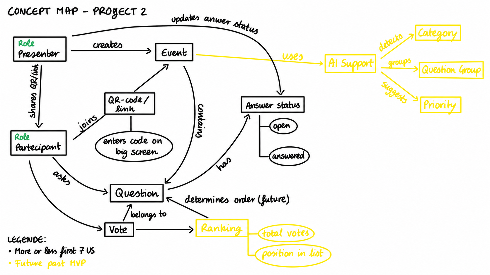

# CONCEPT MAP

## Bounded Contexts and subdomains (Quellen)

**Subdomain:** Ein Subdomain ist ein Teilbereich des Problems, das unsere Anwendung lösen soll.
Es beantwortet die Frage: *Mit welchen fachlichen Aufgaben muss sich unser System beschäftigen?*

**Bounded Context:** Ein Bounded Context ist ein klar abgegrenzter Bereich innerhalb der Software, in dem ein bestimmtes Modell mit einheitlichen Begriffen, Definitionen und Regeln verwendet wird.
Er beantwortet die Frage: *Wie organisieren und trennen wir die verschiedenen Konzepte innerhalb unserer Software?*

### Unsere Bounded Kontexts

### 3.1 Event Management

Verwaltet die Erstellung von Veranstaltungen und den Zugang der Teilnehmer.

**Konzepte:** Event, Presenter, Participant, Access Code, QR Code / Link.

**Beispiel:** Ein Professor erstellt eine Vorlesung und teilt einen Zugangslink mit den Studenten.

### 3.2 Question Management

Verwaltet das Einreichen, Anzeigen und Beantworten von Fragen.

**Konzepte:** Question, Question Text, Answer Status, Presenter.

**Beispiel:** Ein Student stellt eine Frage und der Professor markiert sie später als beantwortet.

### 3.3 Voting & Ranking

Verwaltet Abstimmungen und sortiert Fragen nach der Anzahl ihrer Stimmen.

**Konzepte:** Vote, Voter, Vote Count, Question Ranking.

**Beispiel:** Eine Frage mit 35 Stimmen wird vor einer Frage mit 12 Stimmen angezeigt. Jeder Teilnehmer darf pro Frage nur einmal abstimmen.

### 3.4 AI Question Analysis (zukünftig)

Analysiert Fragen automatisch und unterstützt den Professor bei ihrer Organisation.

**Konzepte:** Category, Question Group, Suggested Priority.

**Beispiel:** Die KI erkennt mehrere ähnliche Fragen zum Thema Primary Keys und schlägt vor, diese zu gruppieren.
